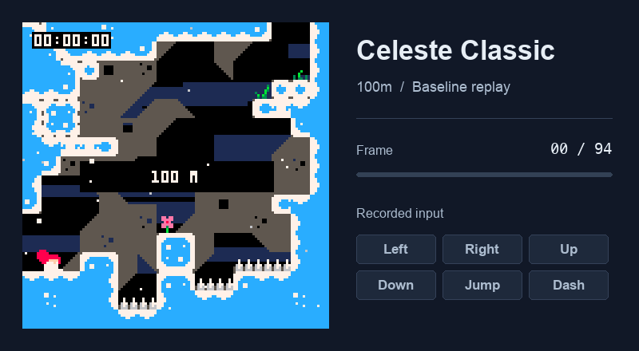

<h1 align="center">GameBench</h1>

<p align="center"><strong>How much can a coding agent improve a working game solution?</strong></p>

<p align="center">
  <a href="#how-a-run-works">Protocol</a> ·
  <a href="#tasks">Tasks</a> ·
  <a href="#experimental-results">Results</a> ·
  <a href="#quick-start">Quick start</a> ·
  <a href="#run-an-agent">Run an agent</a>
</p>

In Celeste Classic, the starting script clears the first room in 94 frames. A coding agent can read the movement code, write a search program, replay a candidate frame by frame, and revise its script. When the session ends, GameBench runs the final script through the engine and counts the frames to the exit. Across **14 tasks in five games**, the same loop measures what a **model and its native harness** can improve together.

<p align="center">
  <a href="docs/replays/celeste-100m.html"></a>
</p>

*Celeste Classic, 100m. The supplied baseline reaches the next room in 94 frames (3.13 s at 30 Hz). To watch offline, unzip the download and open the HTML in a browser. Use Space to play or pause and the arrow keys to inspect the input and engine state one frame at a time.* [Replay page](docs/replays/celeste-100m.html) · [Download the player from GitHub (ZIP)](docs/replays/celeste-100m.zip?raw=true)

## How a run works

1. **Start from the same solution.** Each system gets the task, a working baseline, the game source, a local simulator, and its own workspace. The prompt specifies the objective and submission format. The agent chooses what to inspect, what tools to write, and which changes to try.
2. **Test and revise.** During the research budget the agent can request scored development trials with replays. For the policy games it can vary public training cases by round or evaluate on a fixed public validation set.
3. **Freeze and grade.** At exit or deadline the host freezes the submission on disk. Once every system in the comparison has finished, the host draws final cases for the stochastic games. It independently runs the baseline and each submission on the same cases within each repeat, checks the replays, and reports scores in the game's own units.

## Tasks

| Game | What the agent edits | What the engine measures |
| --- | --- | --- |
| Celeste Classic | A JSON button timeline for one of five rooms (100m, 300m, 400m, 600m, 700m) | **Fewer frames** to reach the next room from a fixed entry and seed. A failed attempt scores 601. |
| shapez | A factory layout for cutting, painting, or stacking | **More correct shapes** delivered on the given map in 3,600 ticks. |
| 2048 | A JavaScript move policy | **Higher mean score** on fresh, paired tile streams, subject to action, CPU, and move limits. |
| Pokémon Showdown | A JavaScript battle policy for the original or expanded task | **Higher battle score rate** (win = 1, tie = ½). In the expanded task one policy faces five opponents across six battle strata, with paired teams and sides. |
| Mindustry | A production blueprint for plastanium, blast compound, or surge alloy | **More target items** in the core after 18,000 ticks on a fixed map. |

The Celeste rooms and factory maps are fixed, so gains measure how much the agent improved that instance. In 2048 and Showdown, final scores also measure how well the policy handles unseen tile streams or lineups and battle seeds. [Task registry](benchmarks/suite.json) · [Scoring contracts](gamebench/registry.py) · [Game playback and asset setup](docs/game-playback.md)

## Experimental results

In one historical Pokémon Showdown comparison, every frozen policy played the same **1,920 battles**. Changing the harness moved the observed score in opposite directions for Qwen and DeepSeek. Each model–harness pair had **one optimization session**. The battle count gives precision about these particular policies, while variation between agent sessions remains unmeasured.

| Model | Native harness | Battle score rate | Change from starting policy |
| --- | --- | ---: | ---: |
| Starting heuristic | — | 53.91% | — |
| Qwen3.8-Max | Qwen Code | 53.91% | +0.00 pp |
| Qwen3.8-Max | Claude Code | 65.89% | +11.98 pp |
| DeepSeek Flash | Official SDK | 77.14% | +23.23 pp |
| DeepSeek Flash | Claude Code | 71.35% | +17.45 pp |
| GPT-6.1 Sol | Codex | 89.27% | +35.36 pp |

Some tasks showed little movement. In a shapez run using the native DeepSeek harness, cutting improved from **23 to 85** correct deliveries and painting from **14 to 38**, while stacking stayed at **11**. The archive gives the baseline, protocol, and units for each experiment across all five games. [Historical tables](results/RESULTS.md) · [Machine-readable data and provenance](results/historical.json)

## Quick start

With **Python 3.12+, Git, and a C++20 compiler** installed, run this from the repository root.

```sh
./bench
```

On first use this fetches the pinned Celeste source, derives the baseline, and builds the headless engine. The default run needs no API key. The expected output is **94 → 94 frames** because the host independently grades two copies of the starting script. Open the printed `index.html` path for the report and replay.

```sh
./bench --list
./bench --tasks shapez-stack mindustry-surge-alloy --out runs/factories
./bench --all --out runs/all-games
./bench --tasks showdown-expanded --submission /path/to/policy-directory --out runs/my-policy
```

Use a fresh directory for each `--out`, or omit it for a timestamped directory. The default `smoke` profile uses small stochastic test sets. The full suite was tested on Apple Silicon macOS with Command Line Tools. 2048 and Showdown use macOS Seatbelt to isolate submitted policies.

## Run an agent

For the official DeepSeek harness, set `DEEPSEEK_API_KEY` in your environment or a local `.env`. The final command below makes paid model calls. The `30m` profile starts **three independent sessions of up to 30 minutes each** for this task.

```sh
python3 -m venv .venv
. .venv/bin/activate
python -m pip install -r requirements-agent.txt
./bench --tasks celeste-100m --system deepseek-default --budget 30m
```

To compare other systems, copy the [system manifest template](benchmarks/systems/external-template.json) for each harness. Set its native launch command, version, model, and required credential names. The command runs in the agent workspace and can use `{python}`, `{workdir}`, and `{instruction}`. Pass the supplied neutral instructions to the harness and register the systems in one invocation so they share final cases.

```sh
./bench --tasks showdown-expanded --budget 30m --system system-a.json --system system-b.json
```

<details>
<summary><strong>Research budgets, test sizes, and host isolation</strong></summary>

Each system gets a fresh home directory and the same starting files and simulation APIs. Inside the workspace, an agent can call `python3 bench.py trial-name [round|validation]` for a development evaluation. Only credential names requested in its manifest are forwarded to the launcher. The bundled DeepSeek adapter keeps the native harness defaults. [DeepSeek manifest](benchmarks/systems/deepseek-default.json)

The smoke profile allows 60 seconds for one session. The 30m, 2h, and 8h profiles each run three fresh sessions per system and task. Preparation and judging are outside the elapsed-time allowance. Token and cost records depend on the harness. [Budget profiles](benchmarks/budgets.json)

| Final cases per repeat | Smoke | Research |
| --- | ---: | ---: |
| 2048 | 2 | 128 |
| Showdown, original | 12 | 1,152 |
| Showdown, expanded | 120 | 1,920 |

Expanded Showdown holds out legal team combinations from the published development splits. The backend is intended for local use by trusted researchers. A native harness can read the host, and the runner does not fully isolate host-wide CPU, memory, disk, network, or detached processes. Use a dedicated machine or VM for untrusted agents.

</details>

<details>
<summary><strong>Installation, offline caches, and reproducibility</strong></summary>

Game sources, Node, Java, and npm dependencies are installed under the checkout as needed. Allow several GB for all game trees and workspaces. Mindustry installs a pinned JDK on macOS arm64. Other Unix hosts can supply a JDK 17+ with `java` and `javac` via `MINDBENCH_JAVA_HOME`. Full-suite verification covers macOS arm64.

For an offline run, point `GAMEBENCH_SOURCE_CACHE` at local Git checkouts named as in the upstream lock, and `GAMEBENCH_DOWNLOAD_CACHE` at the pinned archives (including `server-release.jar` and `mindustry-jdk21.tar.gz` for the automatic JDK). A populated npm cache can be selected with `npm_config_cache` and `npm_config_offline=true`. Node and Mindustry archives are checked by SHA-256. npm builds use lockfiles. [Pinned game sources](benchmarks/upstream.json)

In each run directory, open `index.html` for scores and replays, `comparison.json` for scores across repeats, and `report.json` for paired differences and paths to engine records. The cohort, frozen hashes, and final cases are recorded in `cohort.json`, `sealed.json`, and `private/tests.json`. Recheck a saved evaluation from the same checkout with the following command.

```sh
python3 -m gamebench verify runs/NAME/grading/systems/SYSTEM/TASK/0
```

Release acceptance covered all 14 baseline tasks in a clean macOS arm64 clone and 12 protocol tests. One scripted fixture submitted two Celeste revisions, scoring 93 and then 92 frames. These checks ran without model calls. After setting up Celeste, 2048, and Showdown, run `python3 -m unittest discover -s tests` for the protocol tests. [Acceptance record](results/release-acceptance.json)

Run `python3 tools/history.py --check` to reproduce the historical tables from the committed data. With the original archive, `python3 tools/history.py --archive /path/to/archive --check` also verifies the selected source hashes.

</details>

## Credits and license

The teaser shows **Celeste Classic** by Maddy Thorson and Noel Berry, recorded with the ccleste port. GameBench code and documentation are MIT-licensed. The upstream games and their artwork retain their respective rights. [License](LICENSE) · [Game and dependency credits](THIRD_PARTY.md)
